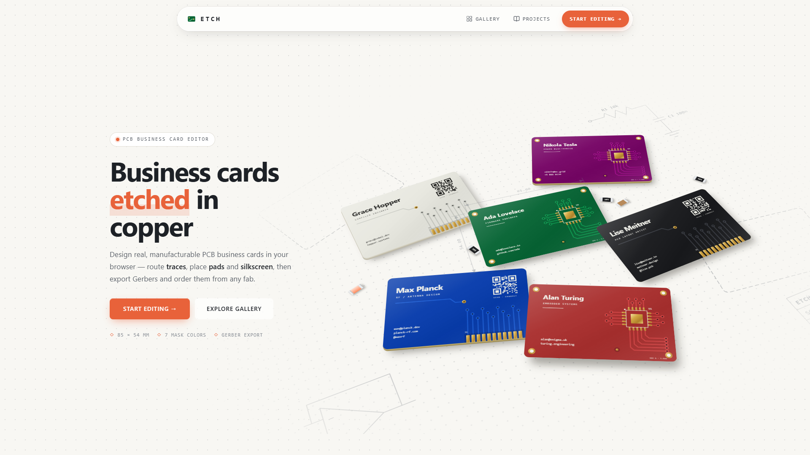
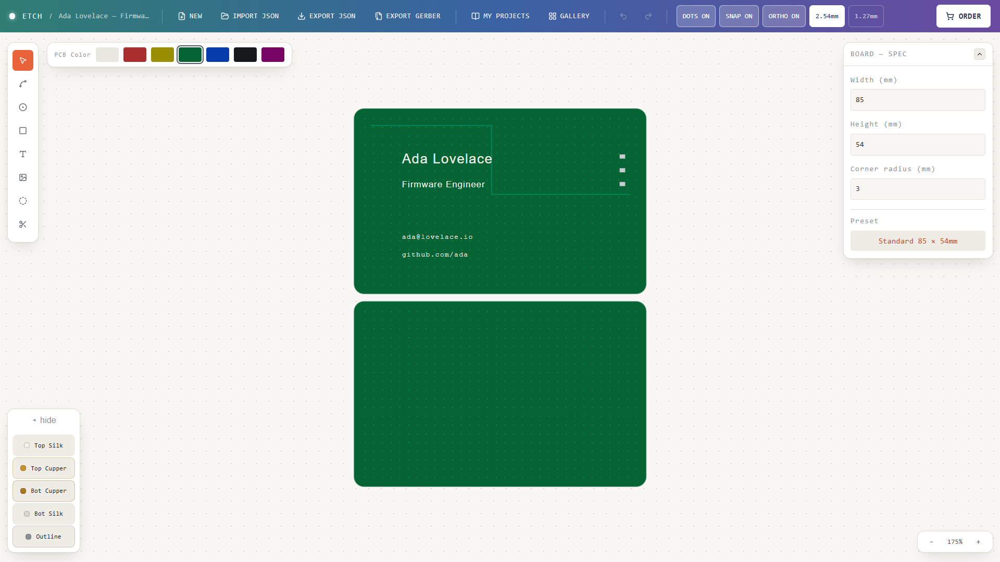
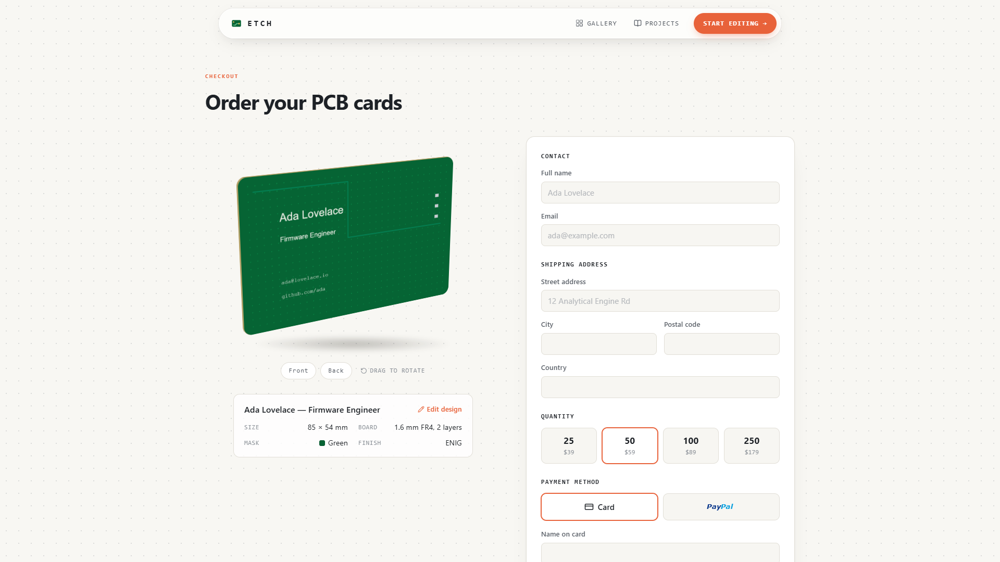

# ETCH — PCB Business Card Editor

**Design real, manufacturable PCB business cards in your browser.** Route copper traces, place pads and silkscreen text, preview both sides of the card, export production-ready Gerbers, and order a batch — no EDA software required.



---

## Editor

A two-sided canvas (top and bottom of the card, shown stacked) with grid snapping, orthogonal routing and a live Board Spec panel.



### Tools

| Tool | What it does |
|---|---|
| **Select** | Pick, move and delete elements. Drag a trace joint to reshape it; click a selected trace to insert a new joint. |
| **Trace** | Click to lay copper points, right-click / <kbd>Enter</kbd> to finish. Snaps onto nearby pads and connects to them. |
| **Pad (THT / SMD)** | Through-hole pads go through both layers; SMD pads sit on the top or bottom copper. |
| **Text / Image** | Silkscreen text (Grotesk, Mono or Serif) and images on either side. |
| **Hole / Cutout** | Mounting holes and custom board cutouts. |

### Keyboard & mouse

| Action | Shortcut |
|---|---|
| Undo / Redo | <kbd>Ctrl</kbd>+<kbd>Z</kbd> / <kbd>Ctrl</kbd>+<kbd>Shift</kbd>+<kbd>Z</kbd> (or <kbd>Ctrl</kbd>+<kbd>Y</kbd>) |
| Delete selected | <kbd>Delete</kbd> / <kbd>Backspace</kbd> |
| Finish trace / cutout | <kbd>Enter</kbd> or right-click |
| Cancel drawing | <kbd>Esc</kbd> |
| Zoom | Mouse wheel, or the zoom control (click the % to reset) |

### Projects

Work is **autosaved** to the browser (local storage) and listed under **My Projects** with a thumbnail. Projects can also be exported/imported as JSON, and the **Gallery** offers ready-made designs to start from.

---

## Ordering

The **Order** button takes the current design to checkout: a draggable 3D preview of the card (front and back), the board spec, quantity tiers and contact/shipping details.



> Pricing on the order page is a placeholder until a fab backend is connected.

---

### Routes

| Path | Page |
|---|---|
| `/` | Landing page |
| `/editor` | Card editor |
| `/gallery` | Community gallery |
| `/projects` | Your saved projects |
| `/order` | Checkout for the current design |
| `/gerber-viewer` | Gerber viewer |

## Tech stack

React 19 · TypeScript · Vite · Tailwind CSS v4 · React Compiler · JSZip · lucide-react · oxlint

## Project layout

```
src/
  pcb-card-editor.tsx   main editor (canvas, tools, history, panels)
  gerberExport.ts       Gerber + drill file generation
  GerberViewer.tsx      Gerber parser and viewer
  OrderPage.tsx         checkout page
  LandingPage.tsx       landing page
  GalleryPage.tsx       gallery of sample designs
  ProjectsPage.tsx      saved projects
  projectStore.ts       local-storage persistence
  colors.ts             UI palette and solder-mask colors
docs/screenshots/       images used in this README
```

## License

Copyright © 2026 18watt. All rights reserved — proprietary and confidential. See [LICENSE](LICENSE).
